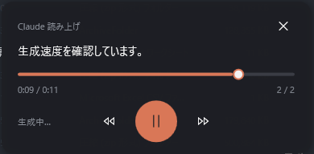

# claude-speak

Claude Code の直前の回答を日本語で読み上げる Claude Code スキル。再生窓は Windows（WSL）版を同梱、他 OS は再生窓だけ実装すれば動く構成です。

Microsoft Edge の音声合成（七海 Neural）で文ごとに音声を作り、生成済みの文から順に Windows 側の小さな再生窓で鳴らします。再生窓には進捗バー・5 秒戻る／進む・一時停止があり、読んでいる文も表示します。



## 動作条件

- Windows 上の WSL2（Ubuntu など）で Claude Code を使っていること（Mac / Linux は下記「Mac / Linux で使うには」）
- `python3` と `python3 -m venv` が使えること
- インターネット接続（音声は Microsoft のサーバーで合成されます。本文が外部へ送られる点に注意）

## 導入

```bash
git clone https://github.com/yu-ya-s/claude-speak.git ~/.claude/skills/speak
~/.claude/skills/speak/install.sh
```

これだけです。Claude Code を起動（または再起動）すると `/speak` が使えます。

更新は `git -C ~/.claude/skills/speak pull` です。

## 使い方

Claude Code の入力で次のように打ちます。

- `/speak` … 直前の回答を読み上げる
- `/speak ゆっくり` / `/speak はやく` … 速さを変える
- `/speak stop` … 止める

再生窓は画面右下に出ます。バーのクリックで移動、両脇のボタンで 5 秒戻る／進む、中央で一時停止、右上の × で停止。読み終わると自動で閉じます。

## カスタマイズ

- 声を変える：`speak.sh` の `VOICE=` を書き換える。一覧は `.venv/bin/edge-tts --list-voices`（日本語は ja-JP-NanamiNeural と ja-JP-KeitaNeural）
- 誤読を直す：`dict.txt` に「語<TAB>読み」を 1 行ずつ追加する（例：`仰る<TAB>おっしゃる`）。音声だけ置き換わり、窓の表示は元の文のままです
- 本文の整形（コードブロックや URL の省き方）：`speak.sh` 内の Python 部分

- 声や実装の切り替え：`config.env` を同じフォルダに置く（git 管理外）。例：

  ```bash
  VOICE=ja-JP-KeitaNeural   # 声
  SYNTH=edge                # synth/<名前>.py
  PLAYER=windows            # player/<名前>.sh（既定は OS から自動判定）
  ```

## 構成

```
speak.sh            本体：本文の整形と文分割、合成と再生窓の起動、停止（OS 非依存）
synth/edge.py       合成：edge-tts で文ごとに mp3 と長さを生成（OS 非依存）
player/windows.sh   再生窓アダプタ（WSL → Windows）
player/windows.ps1  再生窓の実装（WPF）
dict.txt            読み替え辞書
install.sh          導入スクリプト
docs/player-contract.md  再生窓を他 OS 向けに実装するときの契約
```

## Mac / Linux で使うには

OS に依存するのは再生窓だけです。`docs/player-contract.md` の契約に沿って `player/mac.sh`（または `player/linux.sh`）と窓の実装を追加すれば、整形・合成・辞書はそのまま使えます。
作者は Mac の動作確認環境を持っていないため、Mac 版の再生窓は同梱していません。実装した方は Pull Request を歓迎します。

## ライセンス

MIT
